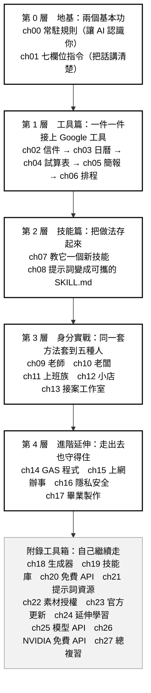
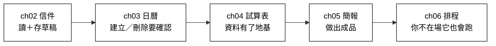
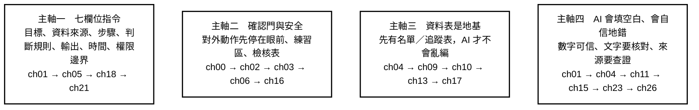

# K141 知識地圖：一張圖看懂《Google Gemini Spark AI 代理人跨域落地師全攻略》

> 曾慶良（阿亮老師）著。本文是依各章重點整理的架構導讀，不含書籍原文。
> 2026-11-17 整理；演練時已把書中的 Gemini Spark 對應到 Anthropic Claude Code（見文末對照表）。

## 一、為什麼這本書看起來「沒有架構」

翻目錄會看到：收信、行事曆、試算表、簡報、排程、技能、老師、老闆、上班族、小店、接案、GAS、上網、安全、資源……
像一串功能清單。其實全書有一條很清楚的主線：

**先立規矩 → 一件一件接上工具 → 把好用的做法存成技能 → 換上不同身分實戰 → 往外延伸並守住安全 → 最後給你資源自己走。**

也就是一個人從「會聊天」到「能指揮 AI 代理人替自己工作」的五個階段，加上一套附錄工具箱。

## 二、全書架構：五層樓＋一個工具箱

| 層 | 章節 | 這一層要學會的一句話 |
| --- | --- | --- |
| 0 地基 | ch00–01 | 先寫規則、再用七個欄位下指令，AI 才做得對 |
| 1 工具 | ch02–06 | 每接一個工具，先在「練習區」試，對外動作一定先停在眼前 |
| 2 技能 | ch07–08 | 調好的做法存成技能檔，一句話叫得出來、帶得走 |
| 3 實戰 | ch09–13 | 每個身分＝一張資料表（地基）＋幾個技能＋一個排程 |
| 4 延伸 | ch14–17 | 會重複的交給程式、外部資料要驗證、風險做成檢核表、最後做自己的 |
| 附錄 | ch18–27 | 生成器、技能庫、API、素材、官方資訊：同一個方法的不同材料 |

## 三、第 1 層的順序是有道理的

工具篇不是隨便排的，而是**風險由低到高、自動化程度由淺到深**：

- 信件：最怕「寄出收不回」→ 學會只存草稿
- 日曆：同一個工具不同動作保護程度不同 → 學會專用練習區
- 試算表：AI 會替你填空白 → 學會把話講到沒有空白
- 簡報：人決定結構、AI 決定版面 → 學會分工
- 排程：你不在現場 → 學會「能唯讀就唯讀、產出放固定位置、留時間戳」

## 四、貫穿全書的四條主軸（真正的骨架）

章節是橫的，這四條是縱的。抓住它們，28 章就串起來了：

1. **七欄位指令**：前五欄說「要做什麼」，後兩欄（判斷規則、權限邊界）說「不要做什麼」，最常被省略、卻最決定穩不穩。
2. **確認門**：凡是會離開你電腦的動作（寄信、邀請、分享、刪除），都先停在你眼前；而且要寫進規則，不能靠 AI 自己問。
3. **資料表是地基**：每個身分實戰都先建一張表（學生名單、行動項目追蹤表、案件追蹤表）。有地基，AI 只要聽名字就會去查；沒有，它會自己編。
4. **AI 會填空白、會自信地錯**：你沒說的它會補；它算數可靠但認字不可靠；它甚至會說「官方文件明確列出」然後給假答案。驗收是人的責任。

## 五、第 3 層：五個身分其實是同一個公式

| 身分 | 章 | 地基（資料表） | 技能 | 自動化 | 這章獨有的教訓 |
| --- | --- | --- | --- | --- | --- |
| 老師 | ch09 | 學生名單／動態紀錄／出缺席 | 一句話記事件 | 親師信草稿 | 沒有名單它會自己編座號 |
| 小公司老闆 | ch10 | 行動項目追蹤表 | 會議秘書 | 晨報 | 容器自己建、內容交給它 |
| 上班族 | ch11 | 報帳表 | 報帳助手 | 每月提醒 | 數字可信、文字要核對 |
| 小店老闆 | ch12 | 客戶偏好紀錄 | 行銷小幫手 | 生日提醒、週貼文 | 沒有截止日的事最容易漏 |
| 接案工作室 | ch13 | 案件追蹤表 | 工作室秘書 | 詢價→報價→催款 | 一條從詢問到入帳的完整流程 |

**公式：身分實戰 = 資料表（地基）＋ 技能（做法）＋ 排程（自動）＋ 確認門（安全）。**
ch17 畢業製作就是讓你用同一個公式，替自己的工作做一套。

## 六、最簡單的吸收方法：三遍讀法

1. **第一遍只讀第 0 層（ch00–01）**：把常駐規則和七欄位範本抄一份成自己的版本。這兩頁是全書的「作業系統」。
2. **第二遍挑一個最像你的身分章（ch09–13 選一）**，倒推回去它用到哪些工具章（ch02–06）和技能章（ch07–08），只讀那幾章。
3. **第三遍讀 ch16 安全規範＋ch17 畢業製作**，填七問規劃表，做出自己的第一套。附錄（ch18–27）當字典，用到再查。

> 一句話記住整本書：**規則先立、指令講清、資料先建、技能存好、對外先停、結果要驗。**

## 七、對照：換成 Anthropic Claude Code 怎麼做

| 書中（Gemini Spark） | Claude Code 對應 |
| --- | --- |
| 常駐規則（個人化設定） | `CLAUDE.md`／記憶 |
| 七欄位指令 | 一樣適用（提示詞骨架） |
| 連結 Gmail／日曆／雲端硬碟 | claude.ai 連接器（MCP） |
| 技能（SKILL.md） | Claude Code Skills（同樣是 SKILL.md 格式） |
| 排程 | claude.ai 雲端排程（routines）、`/loop` |
| 一次生成簡報 | Artifact（簡報、頁面、試算表） |
| 上網辦事 | Claude in Chrome、WebSearch／WebFetch |
| 確認門 | `CLAUDE.md` 規則（軟）＋ 權限 deny 清單（硬） |
